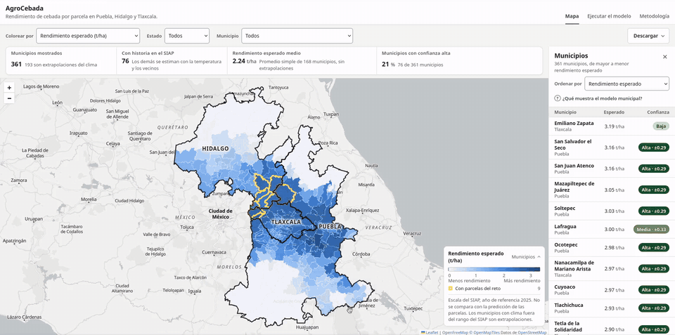
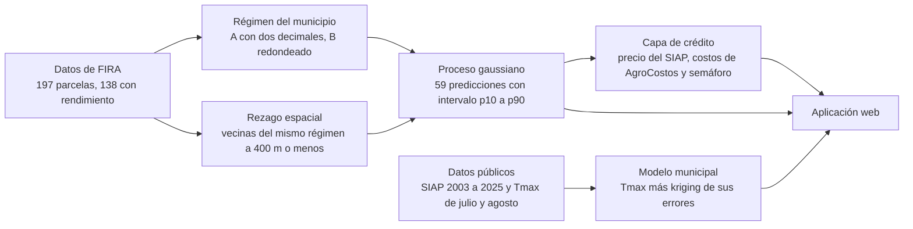
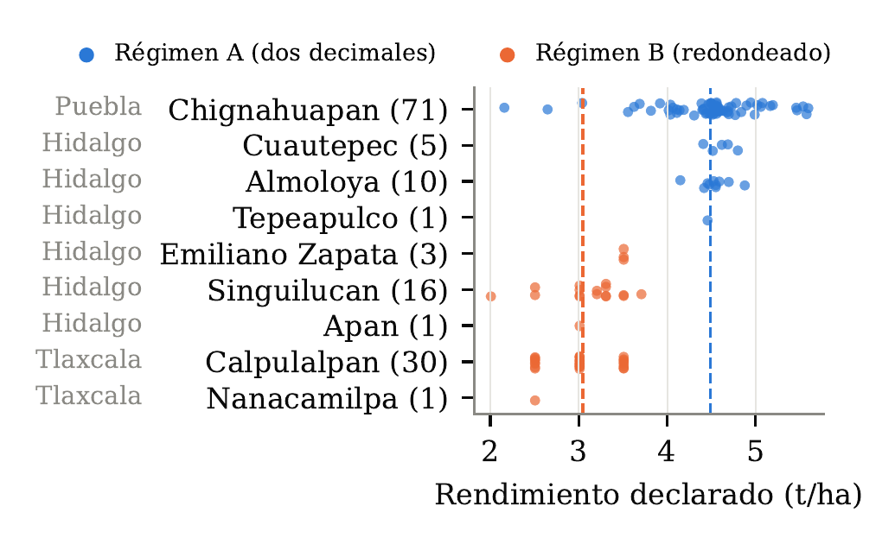
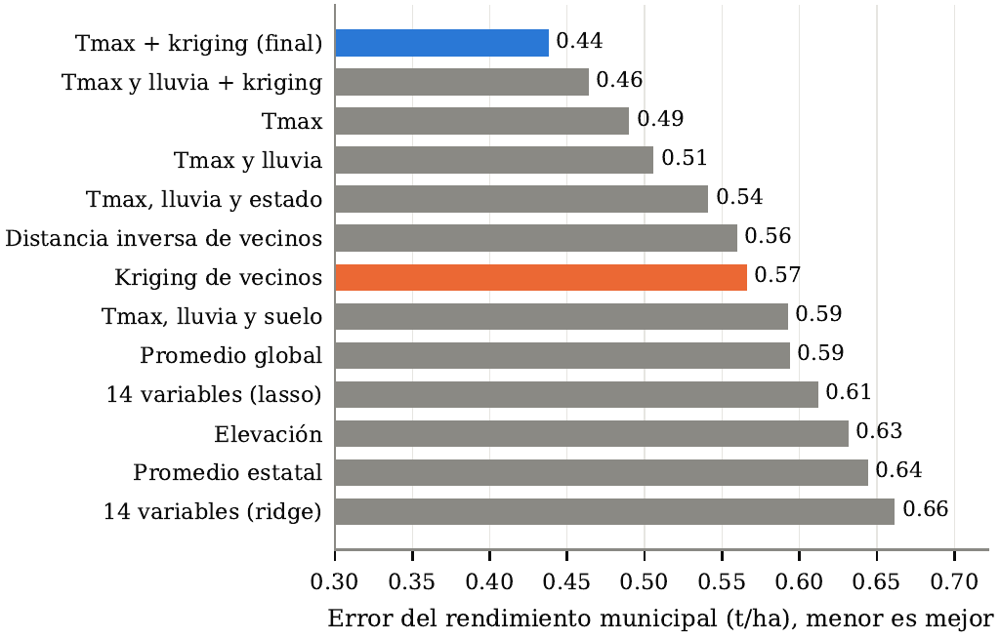
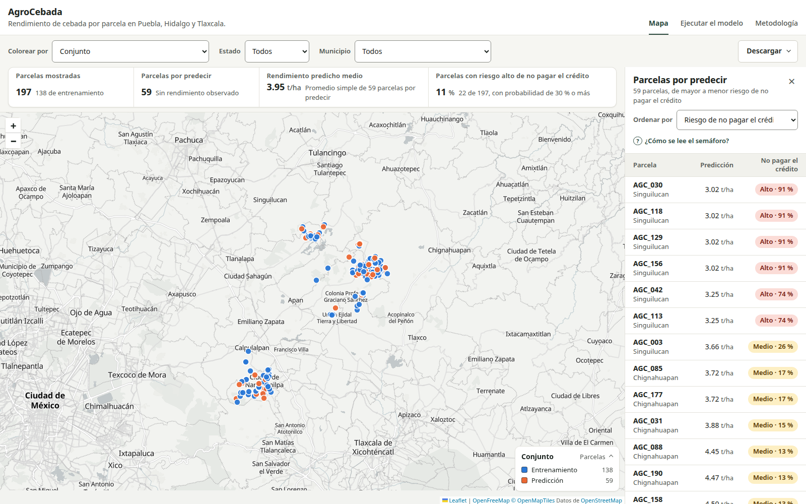
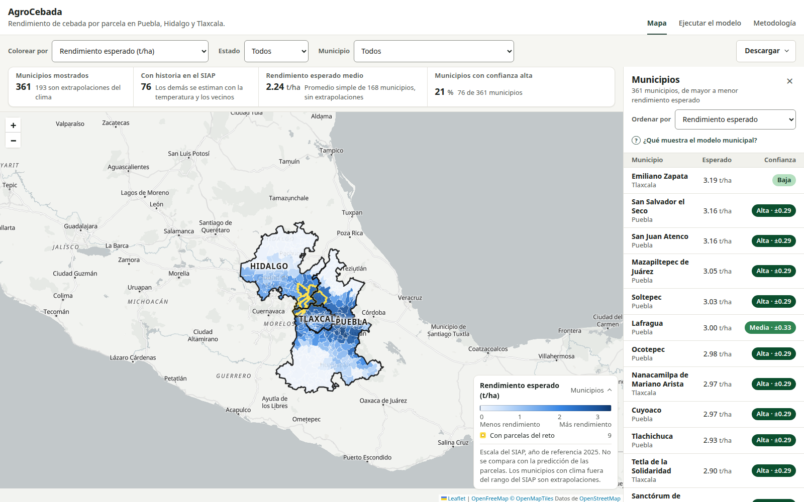
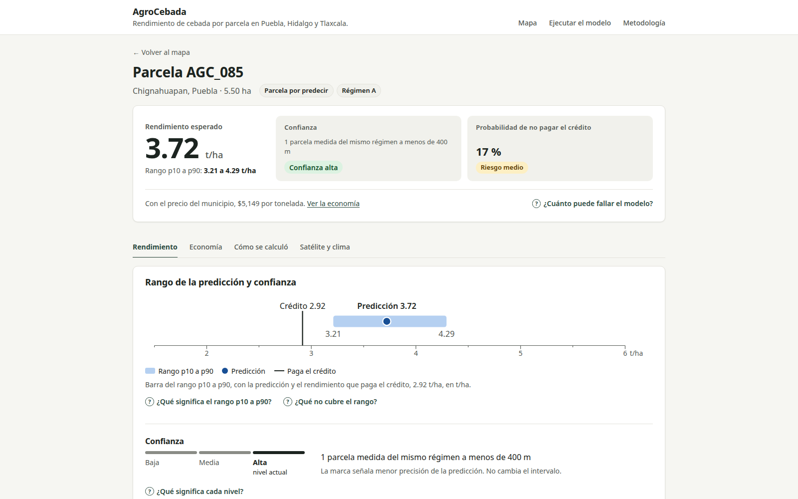
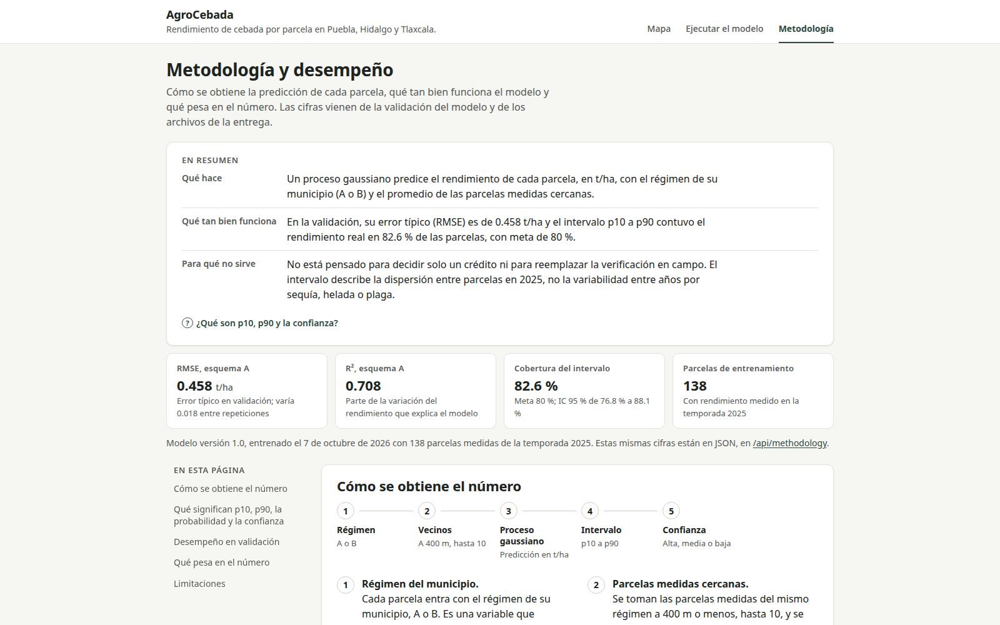
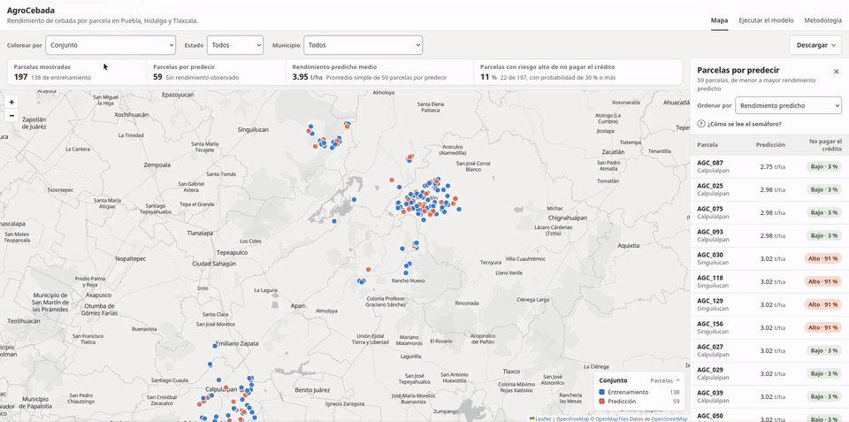

<div align="center">


# Reto AgroCebada

**Rendimiento de cebada de temporal con régimen de registro y rezago espacial**

Equipo Los Bien Dotados · Facultad de Ciencias de la Computación, BUAP · Reto AgroCebada FIRA 2026

[](https://agrocebada.alan-pv.com)
[](https://www.youtube.com/watch?v=4YK2Fag8Y2g)
[](docs/INSTALACION.md)
[](tests)

</div>

Predecimos el rendimiento de cebada de temporal (t/ha) de 59 parcelas de Puebla, Hidalgo y Tlaxcala a partir de 138 parcelas con rendimiento conocido. El modelo usa el régimen de registro de cada municipio y el rendimiento de las parcelas vecinas, con un RMSE esperado de 0.458 t/ha (0.490 en el peor caso) y un rango de rendimiento probable por parcela. Un segundo modelo, entrenado con datos públicos del SIAP y la temperatura de verano, estima el rendimiento esperado de los municipios del altiplano de Hidalgo, Puebla y Tlaxcala, incluso donde no hay parcelas medidas, con un RMSE de 0.44 t/ha donde no hay datos cerca, un rango probable y una confianza alta, media o baja por municipio. Una capa de crédito traduce la predicción de cada parcela a pesos y a riesgo de no pagar el crédito.



## Cómo funciona



El modelo de parcelas solo sirve donde hay parcelas con rendimiento cerca. Buscamos una variable del lugar que explicara la diferencia entre regímenes, y como ninguna la explica, el modelo municipal usa el rendimiento oficial del SIAP para estimar el resto de la región.

## Resultados en una mirada

| | Modelo de parcelas | Modelo municipal |
|---|---|---|
| Datos | 138 parcelas de FIRA, temporada 2025 | SIAP de 2003 a 2025 en 100 municipios y Tmax de julio y agosto |
| Entradas | Régimen del municipio y rendimiento de las vecinas a 400 m o menos | Temperatura máxima de verano más un kriging de sus errores |
| Error | RMSE esperado de 0.458 t/ha en las 59, 0.490 en el peor caso | RMSE de 0.44 t/ha en municipios sin datos cerca, contra 0.57 de copiar a los vecinos |
| Intervalo | p10 a p90, contiene el valor real en 83 % de los casos | p10 a p90, contiene el valor real en 80 a 82 % de los casos. Confianza alta, media o baja según haya historia de cebada propia o cercana en el SIAP |
| Sirve para | Estimar y ordenar parcelas por riesgo al cierre de la temporada | Orientar la planeación en zonas sin parcelas medidas, antes de sembrar |

Criterio en `confianza()` de [capa_municipal.py](scripts/generalizable/capa_municipal.py) y detalle en [MUNICIPAL.md](docs/MUNICIPAL.md).

| Dos formas de registrar el rendimiento | Error de 13 modelos municipales |
|---|---|
|  |  |
| Cada municipio registra el rendimiento con dos decimales (A, media de 4.49 t/ha) o redondeado (B, media de 3.05 t/ha) | Al predecir municipios sin datos del SIAP a menos de 50 km, la Tmax con kriging (azul) supera al kriging de vecinos (naranja) |

## Aplicación

[](https://www.youtube.com/watch?v=4YK2Fag8Y2g)

| Mapa de parcelas | Mapa municipal |
|---|---|
| [](https://agrocebada.alan-pv.com) | [](https://agrocebada.alan-pv.com/#layer=mun-esperado) |
| Las 197 parcelas y las 59 por predecir, ordenadas por riesgo de no pagar el crédito | Rendimiento esperado de los 361 municipios de Hidalgo, Puebla y Tlaxcala |
| **Ficha de una parcela** | **Metodología** |
| [](https://agrocebada.alan-pv.com/parcela/AGC_085) | [](https://agrocebada.alan-pv.com/metodologia) |
| Predicción, intervalo p10 a p90, confianza y probabilidad de no pagar el crédito | Cómo se obtiene el número, su error en validación y sus limitaciones |

<details>
<summary>Recorrido por el mapa municipal</summary>



</details>

## Cómo empezar

Con [uv](https://docs.astral.sh/uv/), que instala Python 3.12 por su cuenta.

```bash
uv sync                                    # instala el entorno
uv run python -m parcelas.predict          # regenera la entrega con el modelo guardado
uv run flask --app app:create_app run      # abre la aplicación en http://127.0.0.1:5000
uv run pytest                              # corre las pruebas
```

Para instalar con pip, ver [INSTALACION.md](docs/INSTALACION.md). Para regenerar todo desde los datos crudos, ver [REPRODUCIR.md](docs/REPRODUCIR.md).

## Entrega

| Archivo | Contenido |
|---|---|
| [outputs/parcelas/los_bien_dotados_prediccion.csv](outputs/parcelas/los_bien_dotados_prediccion.csv) | Predicciones oficiales de las 59 parcelas (`ID_POLIGONO`, `AREA_HA`, `RENDIMIENTO_T_HA`, `CONJUNTO`) |
| [docs/reportes/REPORTE.pdf](docs/reportes/REPORTE.pdf) | Anexo técnico de 4 cuartillas con ecuaciones, figuras y la tabla de las 59 predicciones |
| [docs/reportes/BIBLIOGRAFIA.pdf](docs/reportes/BIBLIOGRAFIA.pdf) | Referencias del reporte |
| [docs/reportes/INFORME.pdf](docs/reportes/INFORME.pdf) | Informe técnico con el texto de cada sección de la plataforma |
| [docs/reportes/PLATAFORMA.txt](docs/reportes/PLATAFORMA.txt) | Texto del informe por campo, tal como se captura en la plataforma |

Reportes de apoyo, con más detalle que el reporte

| Archivo | Contenido |
|---|---|
| [docs/reportes/CONTEXTO.pdf](docs/reportes/CONTEXTO.pdf) | El reto en contexto, supuestos e hipótesis iniciales |
| [docs/reportes/REGIMENES.pdf](docs/reportes/REGIMENES.pdf) | Por qué los municipios registran el rendimiento de dos formas |
| [docs/reportes/MODELO.pdf](docs/reportes/MODELO.pdf) | Procedimiento, arquitectura y evaluación del modelo de parcelas |
| [docs/reportes/MUNICIPAL.pdf](docs/reportes/MUNICIPAL.pdf) | Modelo municipal con datos públicos |

## Documentación

| Documento | Para qué sirve |
|---|---|
| [docs/ESTRUCTURA.md](docs/ESTRUCTURA.md) | Qué hay en cada carpeta y en cada archivo de resultados |
| [docs/INSTALACION.md](docs/INSTALACION.md) | Cómo instalar el entorno |
| [docs/REPRODUCIR.md](docs/REPRODUCIR.md) | Pasos para regenerar la entrega, comprobaciones independientes y uso desde Python |
| [docs/APLICACION.md](docs/APLICACION.md) | Rutas de la aplicación web y su API |
| [docs/DATOS.md](docs/DATOS.md) | Datos del reto, qué es la etiqueta según FIRA, datos públicos y diccionario de variables |
| [docs/VALIDACION.md](docs/VALIDACION.md) | Esquemas de validación cruzada, regla de decisión y modelos de referencia |
| [docs/MODELO.md](docs/MODELO.md) | Modelo de parcelas, cómo se eligió, métricas, uso previsto y limitaciones |
| [docs/CREDITO.md](docs/CREDITO.md) | Capa de crédito, puntos de equilibrio, probabilidades y semáforos |
| [docs/MUNICIPAL.md](docs/MUNICIPAL.md) | Modelo municipal, su validación y los archivos que usa la app |
| [docs/PROMPTS.md](docs/PROMPTS.md) | Uso de inteligencia artificial y prompts principales, como piden las bases |
